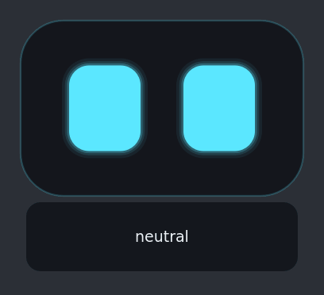

# 🤖 Desk Buddy

**A tiny, private voice assistant that lives in the corner of your Linux desktop.**

Desk Buddy has animated robot eyes and wakes up when you say its wake word. It
answers out loud using your **local [Ollama](https://ollama.com)** model.
Everything runs on your own machine: no cloud, no accounts, no API keys.


-black)


<p align="center">
  
</p>

```
mic ─► openWakeWord ─► record ─► faster-whisper ─► Ollama ─► Piper ─► speakers
           (wake)                    (speech→text)   (LLM)    (text→speech)
                                                        │
                                       [happy] tags ────┴──► eyes change expression
```

## ✨ Features

- **Hands-free:** say a wake word ("hey jarvis" by default) and just talk. It
  keeps listening for a few seconds after it answers, so you can keep the
  conversation going.
- **Expressive eyes:** 11 moods (happy, sad, thinking, surprised, sleepy…). The
  LLM picks its own mood for each reply. When idle, the eyes blink, wander and
  glance at your mouse pointer.
- **Fast replies:** answers are streamed sentence by sentence, so it starts
  speaking before the LLM has finished.
- **100% local:** wake word, speech recognition, LLM and voice all run offline.
- **Easy to change:** one `config.yaml` sets the color, size, wake words,
  voice, language, model and personality.
- **Speaks many languages:** set a multilingual Whisper model and a Piper
  voice (for example Italian).
- **Small window:** transparent, always on top and draggable. It remembers
  where you put it.

## 📋 Requirements

- Linux with a desktop environment (X11, or Wayland through XWayland; see
  [Troubleshooting](#-troubleshooting))
- Python 3.10 or newer
- [Ollama](https://ollama.com) installed and running
- A microphone and speakers (headphones work best)
- About 1–3 GB of disk space for the models. A CPU is enough, and an NVIDIA GPU
  makes it faster.

## 🚀 Quick start

1. Clone the repository:
   ```bash
   git clone https://github.com/gtradigo/desktop-ai-buddy.git
   cd desktop-ai-buddy
   ```
2. Install the system packages (Debian/Ubuntu names; use your distro's equivalents):
   ```bash
   sudo apt install python3-venv libportaudio2 libxcb-cursor0
   ```
3. Install [Ollama](https://ollama.com) and make sure it's running (`ollama serve`,
   or the systemd service the installer sets up).
4. Run the setup. It creates `.venv`, installs the Python packages, and
   downloads the wake-word models, the voice and the Ollama model named in
   `config.yaml`:
   ```bash
   ./setup.sh
   ```
5. Start it:
   ```bash
   ./run.sh            # the real thing
   ./run.sh --demo     # just the eyes, cycling through expressions (no audio needed)
   ./run.sh -v         # with detailed logs
   ```

Say **"hey jarvis"**, wait for the boop, and talk.

## 🎮 Using it

| Action | What happens |
|---|---|
| Wake word | starts listening |
| Double-click the face | starts listening (no wake word needed) |
| Drag the face | moves it anywhere; the position is remembered |
| Right-click | Talk now · Mute · Quit |

Expressions: neutral, listening, thinking, happy, excited, sad, angry,
surprised, confused, sleepy and asleep. The LLM starts each reply with a mood
tag like `[happy]`. The buddy removes the tag before speaking and sends it to
the eyes. After `sleep_after_minutes` without activity it gets sleepy, then
dozes off until you wake it.

## ⚙️ Customizing

All settings are in [`config.yaml`](config.yaml): eye color and size, wake
words, mic and speaker, Whisper model, Ollama model, voice, speed and
personality. Restart the buddy after editing it.

### Wake words

Built-in: `hey_jarvis`, `alexa`, `hey_mycroft`, `hey_rhasspy`. It can listen
for several at once: `words: [hey_jarvis, alexa]`.

**Your own wake word** (for example "hey pip"): openWakeWord can train a model
from synthetic speech, so you don't need any recordings. Use the automatic
training notebook linked from the [openWakeWord repository](https://github.com/dscripka/openWakeWord).
It runs on Google Colab in under an hour. Download the resulting `.onnx`, put
it in a `wakewords/` folder, and set:
```yaml
wake:
  words: [wakewords/hey_pip.onnx]
```
If it triggers too easily, raise `threshold`. If it misses you, lower it.

### Speaking another language (e.g. Italian)

```yaml
stt:
  model: small        # multilingual model (the .en ones are English-only)
  language: it
tts:
  voice: voices/it_IT-paola-medium.onnx
personality: |
  Sei Pip, un piccolo robot allegro che vive sul desktop. Rispondi in italiano, in modo breve.
```
Then download the voice:
```bash
.venv/bin/python -m piper.download_voices it_IT-paola-medium --download-dir voices
```
All voices are listed on the [Piper voices page](https://huggingface.co/rhasspy/piper-voices).

### Models

Small models answer fastest, and for voice, speed matters more than brilliance:
`llama3.2:3b`, `gemma3:4b`, `qwen2.5:7b`. For "thinking" models (qwen3,
deepseek-r1), set `think: false`, or the buddy will pause while the model reasons.

## 🔁 Start on login

```bash
mkdir -p ~/.config/autostart
cat > ~/.config/autostart/desk-buddy.desktop <<EOF
[Desktop Entry]
Type=Application
Name=Desk Buddy
Exec=$PWD/run.sh
X-GNOME-Autostart-Delay=10
EOF
```

## 🛠 Troubleshooting

- **The window isn't on top, or can't be moved (Wayland):** some Wayland
  compositors (notably GNOME) ignore "always on top" and window positions.
  Run it through XWayland instead: `QT_QPA_PLATFORM=xcb ./run.sh`.
- **Black box instead of a transparent window:** your desktop has no
  compositor. Enable one, or keep `face_plate: true` so the box looks intentional.
- **Wrong microphone:** list the devices with `.venv/bin/python -m sounddevice`
  and set `audio.input_device` to a name or number.
- **Never stops listening:** raise `audio.speech_level` (e.g. 500–800).
  **Cuts you off:** lower it, or raise `silence_seconds`.
- **It hears itself:** use headphones, or set `follow_up_seconds: 0`.
- **"Can't reach Ollama":** check `curl http://localhost:11434/api/tags`.
- **Slow answers:** use a smaller Whisper model (`tiny.en`) and LLM. On an
  NVIDIA GPU, set `stt.device: cuda` and `compute_type: float16`.
- **`Fatal Python error: none_dealloc: deallocating None`:** PySide6 6.12.0 has a
  reference-leak bug that crashes on Python 3.10/3.11. Fix it with
  `.venv/bin/pip install "PySide6>=6.5,<6.12"` (`requirements.txt` already pins this).

## 🧩 How it works

| File | What it does |
|---|---|
| [`buddy.py`](buddy.py) | entry point: loads the config, opens the window, starts the voice thread |
| [`eyes.py`](eyes.py) | the animated eyes window (PySide6, drawn with QPainter at 60 fps) |
| [`brain.py`](brain.py) | wake word → speech-to-text → Ollama → text-to-speech pipeline (background thread) |
| [`config.yaml`](config.yaml) | all settings |
| [`setup.sh`](setup.sh) / [`run.sh`](run.sh) | install and launch |

The voice pipeline runs in its own thread and sends Qt signals to the window
(mood, captions, "speaking"), so the animation never stutters while models run.
The LLM reply is streamed and split into sentences. Each sentence is synthesized
and played as soon as it is complete, and the mouth-like "pulse" of the eyes
follows the loudness of the voice.

## 🙏 Built with

- [openWakeWord](https://github.com/dscripka/openWakeWord): wake word detection
- [faster-whisper](https://github.com/SYSTRAN/faster-whisper): speech-to-text
- [Ollama](https://ollama.com): local LLM runtime
- [Piper](https://github.com/rhasspy/piper): text-to-speech
- [PySide6](https://doc.qt.io/qtforpython-6/): the window and eyes

## 📄 License

[MIT](LICENSE)
